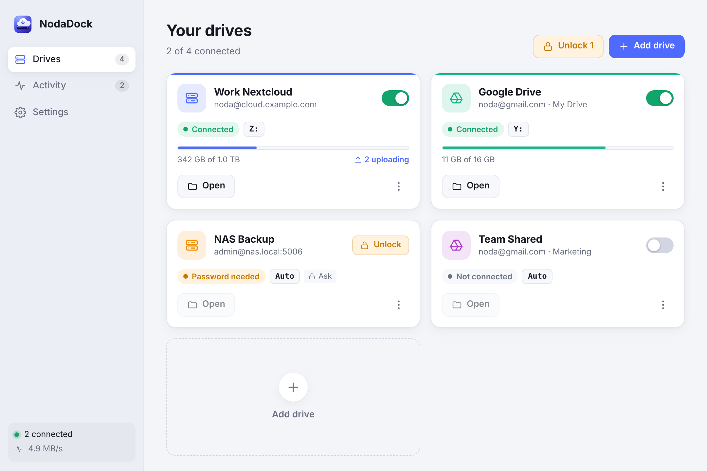
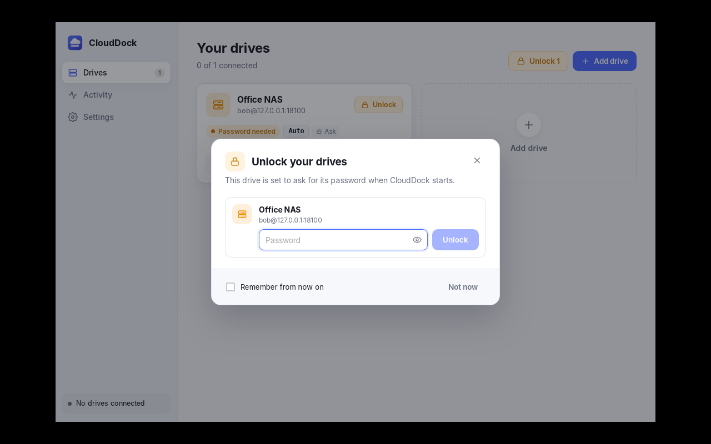
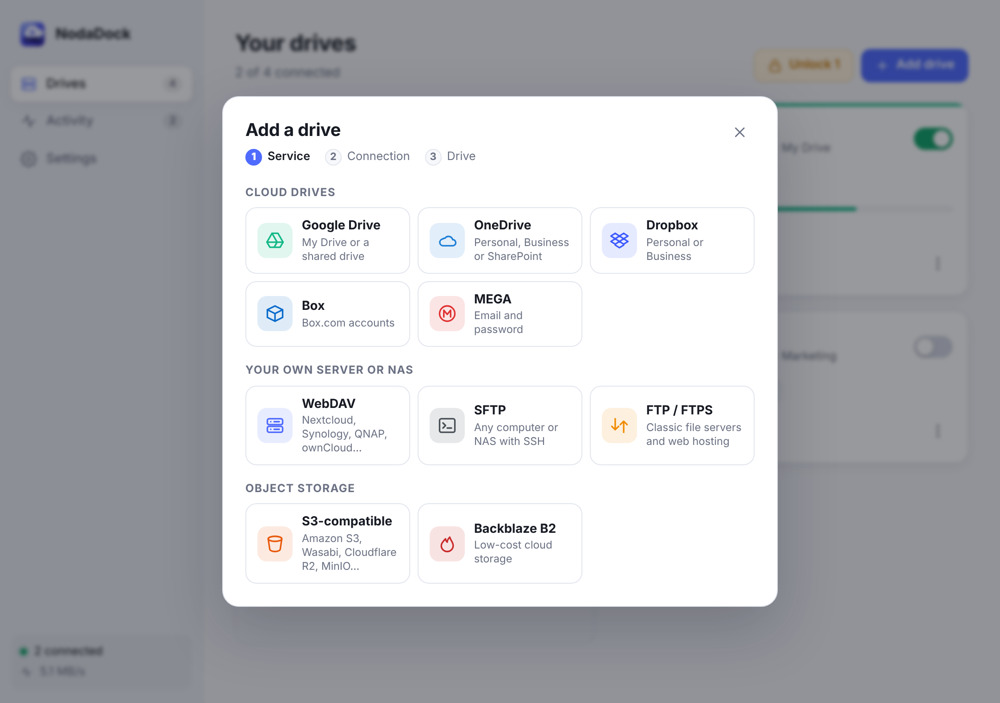

# NodaDock

Use your WebDAV server or Google Drive like a normal disk on **Windows** and **macOS**.
A drive gets its own letter in File Explorer (for example `Z:`) or appears in Finder,
reconnects by itself after a restart, and needs **no account or sign-up**.



NodaDock is an original app. It is inspired by what tools like NetDrive do, but shares
no code, artwork or design with them.

## What it does

- **WebDAV**: Nextcloud, ownCloud, Synology, QNAP, SharePoint (on-premises), Fastmail, or any WebDAV server.
- **Google Drive**: My Drive or any shared drive, signed in once through your browser.
- **Your choice of password handling, per drive**
  - *Remember it*: kept in Windows Credential Manager / macOS Keychain, never in a plain file.
    The drive reconnects on its own after every restart.
  - *Ask every time*: the password is never saved. After a restart NodaDock pops up and asks
    for it (screenshot below), then connects.
- **Starts with your computer** (optional), quietly in the system tray / menu bar.
- **Safe disconnect**: if files are still uploading, NodaDock warns you instead of cutting them off.
  Unfinished uploads stay on your computer and finish the next time the drive connects.
- **Smart caching** so Office, photo apps and previews work smoothly, with a size limit you choose.
- Live upload/download activity, storage usage per drive, read-only mode, drive colours,
  light and dark themes, network-drive mode on Windows.

| After a restart ("Ask every time") | Adding a drive |
|---|---|
|  |  |

## Getting the installers

You don't need to install any developer tools.

1. Put this folder in a GitHub repository (or ask Claude to push it to one for you).
2. On GitHub, open **Actions → Build installers → Run workflow**.
3. After about 10–15 minutes, download from the finished run:
   - `NodaDock-windows-x64` → `NodaDock_0.1.0_x64-setup.exe` (or the `.msi`)
   - `NodaDock-macos-apple-silicon` / `NodaDock-macos-intel` → `NodaDock_0.1.0_*.dmg`

Pushing a tag like `v0.1.0` runs the same build.

### One-time driver install

- **Windows** needs [WinFsp](https://winfsp.dev/rel/) (free, open source) to show drive letters.
  NodaDock tells you if it is missing and links to it.
- **macOS** works out of the box using the built-in NFS client. If you prefer, install
  [FUSE-T](https://www.fuse-t.org/) or [macFUSE](https://osxfuse.github.io/) and NodaDock uses it automatically.

### Unsigned app warnings

The builds are not code-signed yet (that needs a paid Apple Developer / Windows signing certificate).
- Windows SmartScreen: click **More info → Run anyway**.
- macOS: right-click the app → **Open**, or run `xattr -cr /Applications/NodaDock.app` once.

Add signing secrets to the workflow later to remove these warnings.

## How it works

```
┌────────────── NodaDock (Tauri) ──────────────┐
│  React UI  ◄──commands/events──►  Rust core   │
│                                    │  │       │
│        OS keychain ◄── secrets ────┘  │       │
│                                       ▼       │
│           private `rclone rcd` (127.0.0.1, random credentials)
└───────────────────────────────────────┬───────┘
                                        ▼
            WinFsp / FUSE-T / macFUSE / NFS  →  Z:  or  ~/NodaDock/<Drive>
```

- The UI is React + TypeScript; the core is Rust (Tauri 2).
- Mounting uses [rclone](https://rclone.org) (MIT licensed), bundled inside the app and driven through
  its local remote-control API. Remotes are built on the fly, so **no rclone config file with your
  passwords is ever written**, and rclone's logs show a hash instead of server details.
- Drive settings (no secrets) live in `drives.json` / `settings.json` in the app's config folder.

## Developing

Requirements: Node 20+, Rust (stable), and on Linux the WebKitGTK dev packages.

```bash
npm install
npm run fetch-rclone        # downloads rclone into src-tauri/binaries/
npm run tauri dev           # runs the real app
npm run dev                 # UI only, in a browser, with demo data (?demo=empty, ?demo=unlock, ?os=macos)
```

Tests:

```bash
cargo test --manifest-path src-tauri/Cargo.toml
# full mount cycle against a local WebDAV server (needs rclone + FUSE):
NODADOCK_E2E=1 cargo test --manifest-path src-tauri/Cargo.toml e2e -- --nocapture
```

Project layout:

| Path | What's there |
|---|---|
| `src/` | React UI (`App.tsx`, `components/`), `api.ts` (backend calls), `mock.ts` (browser demo backend) |
| `src-tauri/src/lib.rs` | App state, commands, tray, startup auto-mount, quit handling |
| `src-tauri/src/mount.rs` | Builds rclone remotes and mount options, friendly error messages |
| `src-tauri/src/rclone.rs` | Starts and talks to the private rclone daemon |
| `src-tauri/src/google.rs` | Google sign-in, account e-mail, shared drives |
| `src-tauri/src/secrets.rs` | Credential Manager / Keychain storage |
| `src-tauri/src/platform.rs` | Driver detection, free drive letters |
| `.github/workflows/build.yml` | Builds Windows and macOS installers |

## Google Drive and API limits

By default NodaDock signs in with rclone's shared Google app ID, which Google rate-limits across all
its users. For heavy use, create your own OAuth client (Google Cloud Console → APIs & Services →
Credentials → OAuth client ID → Desktop app), enable the Drive API, and enter the ID and secret under
**Show advanced options** when adding the drive.

## License

MIT. Bundles rclone (MIT). WinFsp, FUSE-T and macFUSE are installed separately under their own licenses.
